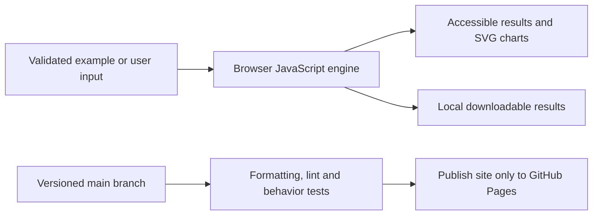

# Stock Analysis Lab

**Reproducible versions:** [Dependency versions and exact setup](DEPENDENCIES.md).


[Open the application](https://subhashdixit.github.io/stock-analysis-lab/) · [Report an issue](https://github.com/subhashdixit/stock-analysis-lab/issues)

The original stock notebook/app required an older Python neural-network stack and a live data fetch. The maintained browser app provides a reproducible price-analysis study with real attributed historical data, transparent baselines and explicit temporal evaluation.

## What the finished application does

- Load a 506-row historical AAPL example or upload a date/close CSV.
- Inspect prices, trailing 20/50-observation means, log-return volatility and maximum drawdown.
- Compare three forecasting methods on chronological validation/test intervals.
- Inspect recursive future observation forecasts and export forecast/test rows.

## Use the application step by step

1. Open the live application. Read the input labels and scope panel.
2. Start with the included example to understand the output.
3. Replace it with your own supported input. Files are processed locally unless you explicitly choose a server feature and consent to it.
4. Run the analysis and inspect the visual output together with its limitations.
5. Export your results when the tool offers a download. Keep your own copy; a browser tab is not a durable data store.

## Concepts, algorithms and interpretation

### Why three baselines?

Last price predicts the next observation equals the latest observed price. It is a strong benchmark because short-term financial changes are difficult to predict. Drift adds the mean price increment learned in the fitting interval; it extrapolates a persistent trend and can fail at regime changes. AR5 ridge learns a weighted linear combination of the preceding five prices, plus an intercept. Training-only normalization centers/scales prices, and an L2 penalty of 1 stabilizes correlated lag coefficients. The intercept is not penalized. A pivoted linear solver solves the regularized normal equations. This is linear autoregression, not the original LSTM.

### Preventing leakage

Split observations in time: first 60% train, next 20% validate, last 20% test. Select a method by validation MAE. Fit it again using train+validation, freeze its parameters and score each test point from only prior observed prices. This is rolling **one-step** evaluation; it is not a 20%-length blind future forecast. Finally refit the selected method on all observations and forecast recursively for 1–20 future observation steps, feeding predictions back as lag values. Validation-selected models may still fail outside this history.

### Interpreting the measures

MAE is average absolute price error in source price units and is easy to interpret. RMSE penalizes large errors more heavily but can be dominated by outliers. Neither proves profitability. Volatility is the sample standard deviation of log returns per supplied observation; it is deliberately not annualized without an established trading calendar. Maximum drawdown is the largest historical percentage decline from a preceding peak. Trailing means have no future input; their initial incomplete windows are not plotted. No confidence interval is produced.

The deterministic linear-series test provides a known expected drift forecast, and the future-mutation test verifies a later target cannot change earlier predictions. These checks test the implementation, not market predictability.

## Architecture and data flow



HTML provides the accessible page structure, CSS handles responsive layout, and ES modules separate calculation from user interaction. Pure calculation functions can run in Node tests without a browser. SVG charts scale with the screen; they use explicit axes, labels and legends. CSV exports escape spreadsheet formula prefixes in text cells.


## Run locally from scratch

Install Node.js 22 and Python 3 for a local static HTTP server. Python is not a production backend for this app.

```bash
git clone https://github.com/subhashdixit/stock-analysis-lab.git
cd stock-analysis-lab
npm ci
npm test
npm run lint
npm run format
npm run check
python3 -m http.server 8000 --directory site
```

Open http://localhost:8000. Use HTTP rather than double-clicking HTML so that module imports and local data fetches work consistently. No production API secret belongs in `site/`.

## Coding structure

```text
site/
  index.html       # accessible application interface
  styles.css       # responsive design
  app.js           # interface orchestration
  engine.js        # validated calculations; no DOM dependency
  ui.js            # chart, CSV and download helpers
tests/             # behavior and boundary cases
.github/workflows/pages.yml
archive/           # original README and retired workflows where present
```

Original source files, notebooks and historical artifacts remain in the repository for comparison. The release publishes only `site/`; old source directories and datasets are not automatically exposed by the application.

## CI/CD and deployment

CI means continuous integration: each pull request and main-branch push installs exact lockfile dependencies, checks formatting, lints JavaScript, runs meaningful behavior tests and checks module syntax. A failed check stops publishing. CD means continuous deployment: after the required `Build and test` check succeeds on `main`, GitHub Actions uploads `site/` and GitHub Pages serves it over HTTPS.

The workflow uses pinned action revisions, minimal permissions and a protected main branch. Publishing jobs need Pages/OIDC permissions; test jobs only read source. Feature branches are deleted after merge. Static Pages hosting needs no always-running Python process, but cannot hide secrets, host a Flask process or provide durable server storage.

To set up a fork, enable GitHub Pages with **GitHub Actions** as its source and allow the repository's workflow to run. Repository Settings → Pages shows the deployment URL. If renaming the repository, update the README URL and any absolute links; application resources use relative paths. Check Actions logs if publishing fails.

### Release, monitoring and rollback

A commit identifies exactly which source was deployed. Inspect the Actions deployment and test results before sharing the link. After publishing, open the page, run its example and check exports; a successful HTTP response alone is not a functional test. For rollback, revert the faulty merge in a new PR, pass checks, and merge the revert. This triggers the same reproducible publishing process. Avoid force-pushing protected main or deleting history. Browser caches can retain an older asset briefly; refresh after a deployment.

### Docker and alternatives

Docker packages code and dependencies into a reproducible runtime. This static app does not require a container: Pages serves the same versioned files directly, with less operating work and no container cold starts. A container becomes useful if adding a Python backend; then secrets, patches, resource costs and persistent storage require separate management.

## Data provenance and attribution

Historical example: [Plotly datasets finance-charts-apple.csv](https://github.com/plotly/datasets/blob/master/finance-charts-apple.csv), AAPL.Adjusted column, 506 rows from 2015-02-17 through 2017-02-16. Plotly datasets is MIT licensed; see `site/data/PLOTLY-LICENSE`. Values are not current market data. Original Stock_Predictor_WebApp files and model artifacts remain for learning; they are not executed by the Pages release.

## Practical limits

No live quote service, trading actions, LSTM inference, stationarity guarantee or investment recommendation. Price-adjustment policy depends on the source. Imported prices must be positive; daily calendar gaps and holidays are preserved rather than fabricated. Forecast horizon uses observation indices. A stable historical backtest can fail after market conditions change.

The test suite checks calculation contracts and invalid inputs. It cannot establish that an input dataset is representative, that a heuristic is scientifically correct for every domain, or that a result is suitable for an automated consequential decision. Read the original source alongside the maintained browser implementation when comparing behavior.

## Local dependency installation

The maintained app is HTML/CSS/JavaScript and needs no Python packages. `requirements.txt` documents this; install development tools with `npm ci` using the pinned Node/npm versions. See [DEPENDENCIES.md](DEPENDENCIES.md). Original prototype requirements are preserved at `archive/prototype-requirements.in` where present; they are not the supported install command.
